# Trabajo Práctico N.º 4 — Módulos del Kernel de Linux

## Estructura del proyecto

```text
TP4/
├── README.md
├── Capturas/                        # Evidencias numeradas (01 a 27)
├── Checkinstall/                    # Código fuente, Makefile y paquetes .deb generados
├── Llamadas_con_Strace/             # Programa hola_mundo.c y binario para traza con strace
├── Modulo_propio/                   # Código fuente (modulo_propio.c), Makefile y .ko (x86_64)
├── Raspberry/
│   └── modulo_raspberry/            # Código fuente, Makefile y .ko compilado para ARM64 (aarch64)
├── modulos_augusto.txt              # Salida de lsmod (Ubuntu en VirtualBox)
├── modulos_disponibles_augusto.txt  # Listado de módulos disponibles en disco
├── modulos_lorenzo.txt              # Salida de lsmod (Ubuntu en WSL2)
└── diff_modulos.txt                 # Diferencias entre módulos cargados en ambos equipos
```

---

## Entorno base: compilación, carga y descarga del módulo de ejemplo

Antes de desarrollar las actividades, se compiló y probó el módulo base de la cátedra (`mimodulo.c`) sobre Ubuntu en VirtualBox (kernel `7.0.0-42-generic`, arquitectura `x86_64`).

```bash
make all
sudo insmod mimodulo.ko
sudo dmesg | tail
lsmod | grep mimodulo
sudo rmmod mimodulo.ko
sudo dmesg | tail
```

| Compilación (`make all`) | Carga (`insmod` + `dmesg`) | Descarga (`rmmod` + `/lib/modules`) |
| :---: | :---: | :---: |
| 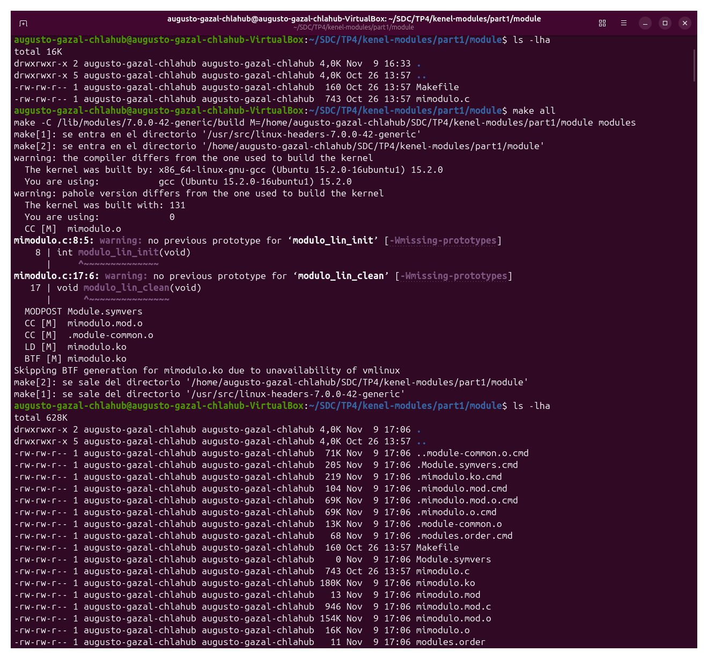 | 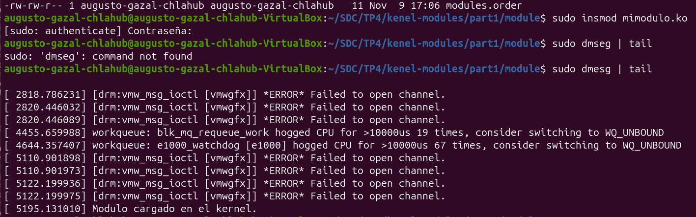 | 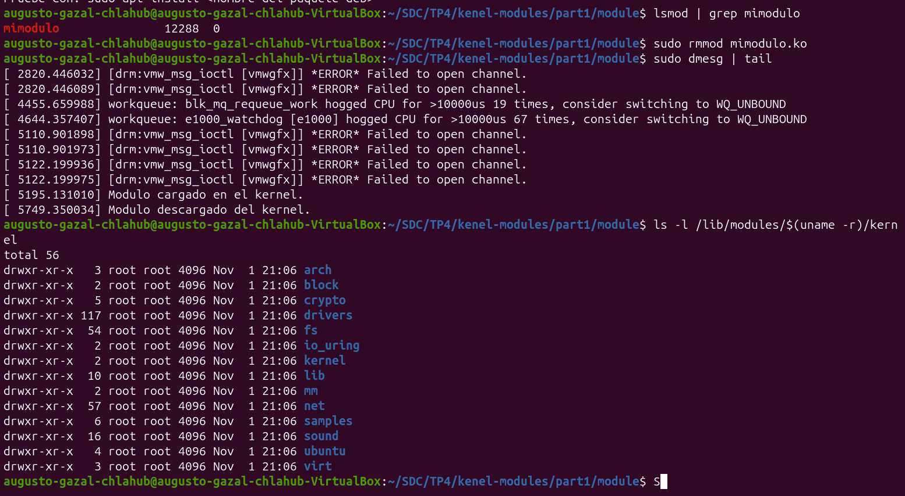 |

---

## Actividades prácticas obligatorias

### 1. Comparación de `modinfo`: módulo propio (`mimodulo.ko`) vs. módulo del sistema (`des_generic`)

Se ejecutó `modinfo mimodulo.ko` y `modinfo des_generic` para contrastar un módulo externo (*out-of-tree*) compilado localmente contra un módulo oficial incluido en la distribución.

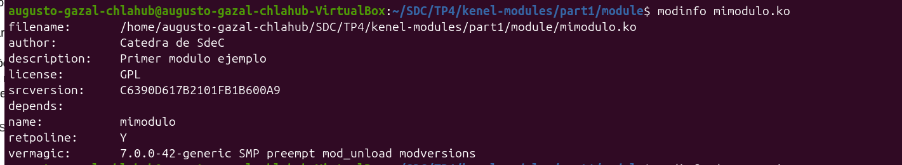
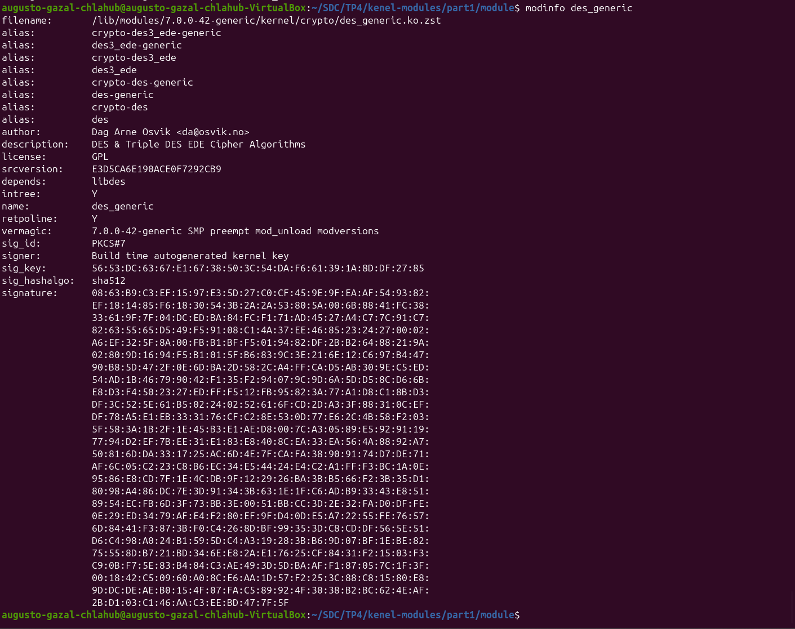

| Campo / Característica | `mimodulo.ko` (externo) | `des_generic.ko.zst` (sistema) |
| :--- | :--- | :--- |
| **Ubicación y compresión** | Directorio local del usuario, sin comprimir (`.ko`) | `/lib/modules/7.0.0-42-generic/kernel/crypto/`, comprimido con Zstandard (`.ko.zst`) |
| **Origen (`intree`)** | No posee `intree: Y` (es un módulo *out-of-tree*, por lo que al cargarse marca al kernel como *tainted*) | `intree: Y` (forma parte oficial del árbol de código fuente del kernel) |
| **Alias (`alias`)** | Ninguno (se carga manualmente) | Múltiples alias (`crypto-des`, `des3_ede`, etc.) que permiten su carga automática bajo demanda mediante `modprobe` |
| **Dependencias (`depends`)** | Ninguna | Depende del módulo `libdes` |
| **Firma criptográfica (`sig_id`, `signer`, `signature`)** | Ausente (sin firmar originalmente) | Firmado digitalmente (`PKCS#7`, `sha512`, `Build time autogenerated kernel key`) |
| **Compatibilidad (`vermagic`)** | `7.0.0-42-generic SMP preempt mod_unload modversions` | Coincide exactamente con la misma cadena `vermagic` del kernel activo |

---

### 2. Listado de módulos cargados en los equipos del grupo y análisis con `diff`

Se capturó la salida de `lsmod` en las máquinas de ambos integrantes y se subieron los archivos [`modulos_augusto.txt`](modulos_augusto.txt) y [`modulos_lorenzo.txt`](modulos_lorenzo.txt).

- **Augusto (Ubuntu en VirtualBox — kernel `7.0.0-42-generic`):** 55 módulos cargados (`lsmod | wc -l` devuelve 56 contando el encabezado) y 6.901 módulos disponibles en disco.
- **Lorenzo (Ubuntu en WSL2 — kernel `6.18.33.2-microsoft-standard-WSL2`):** 13 módulos cargados (`lsmod | wc -l` devuelve 14 contando el encabezado) y 961 módulos disponibles en disco.

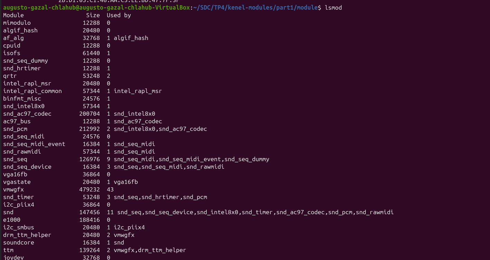
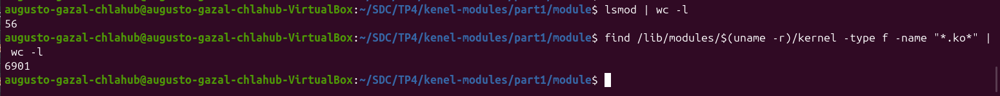
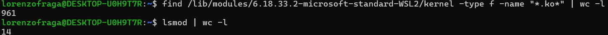

#### Procedimiento del `diff`

Un `diff` directo sobre la salida cruda de `lsmod` produce falsas diferencias en todas las líneas, porque las columnas `Size` y `Used by` varían según la versión del kernel y el uso actual, y además `lsmod` no ordena alfabéticamente. Para comparar correctamente los módulos presentes en cada equipo, se extrajo únicamente la primera columna (nombre del módulo), se eliminó el encabezado y se ordenó antes de aplicar `diff -u`:

```bash
awk '{print $1}' modulos_augusto.txt | tr -d '\r' | grep -v '^Module$' | sort > /tmp/augusto.txt
awk '{print $1}' modulos_lorenzo.txt | tr -d '\r' | grep -v '^Module$' | sort > /tmp/lorenzo.txt
diff -u /tmp/augusto.txt /tmp/lorenzo.txt > diff_modulos.txt
```

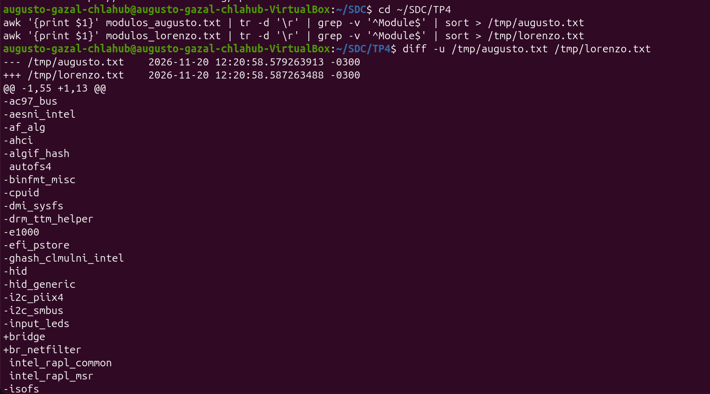

#### Explicación de las diferencias

- **Módulos en común (4):** únicamente `autofs4` (automontaje de sistemas de archivos), `intel_rapl_common` e `intel_rapl_msr` (gestión y medición energética de CPU Intel) y `sch_fq_codel` (disciplina de colas de red).
- **Exclusivos de Augusto / VirtualBox (51, prefijo `-`):** VirtualBox emula una computadora de escritorio completa con periféricos PCI/USB virtuales, por lo que el kernel genérico de Ubuntu carga drivers específicos de gráficos (`vmwgfx`, `drm_ttm_helper`, `ttm`, `vga16fb`), tarjeta de red Ethernet (`e1000`), subsistema completo de audio (`snd_*`, `ac97_bus`, `soundcore`), almacenamiento y entrada (`ahci`, `libahci`, `psmouse`, `usbhid`, `hid_generic`), integración con el hipervisor (`vboxguest`) y el módulo de práctica (`mimodulo`).
- **Exclusivos de Lorenzo / WSL2 (9, prefijo `+`):** WSL2 utiliza un kernel personalizado y minimalista de Microsoft sin periféricos de audio, video ni bus PCI tradicional, y compila gran parte de sus capacidades de forma estática (*built-in*). Los módulos cargados allí corresponden a virtualización anidada (`kvm`, `kvm_intel`, `irqbypass`) y a redes virtuales/contenedores/túneles (`bridge`, `br_netfilter`, `stp`, `llc`, `ip_tables`, `tun`).

---

### 3. Módulos disponibles pero no cargados y ausencia de drivers

#### ¿Cuáles módulos están disponibles pero no cargados?
Los módulos disponibles en disco se encuentran almacenados en `/lib/modules/$(uname -r)/kernel/` (comprimidos como `.ko.zst` en Ubuntu). Mediante:

```bash
find /lib/modules/$(uname -r)/kernel -type f -name "*.ko*"
```

se verificó que el equipo de Augusto dispone de **6.901 módulos** en disco (ver listado completo en [`modulos_disponibles_augusto.txt`](modulos_disponibles_augusto.txt)), de los cuales solo **55** están cargados en RAM. Es decir, existen **6.846 módulos disponibles pero inactivos**, correspondientes a drivers de hardware no presente en esta máquina (por ejemplo, decenas de chips RTC en `drivers/rtc/`, placas Wi-Fi, sistemas de archivos exóticos, sensores industriales, etc.). Esto demuestra la ventaja de la arquitectura modular de Linux: ahorra memoria RAM cargando dinámicamente solo lo necesario.

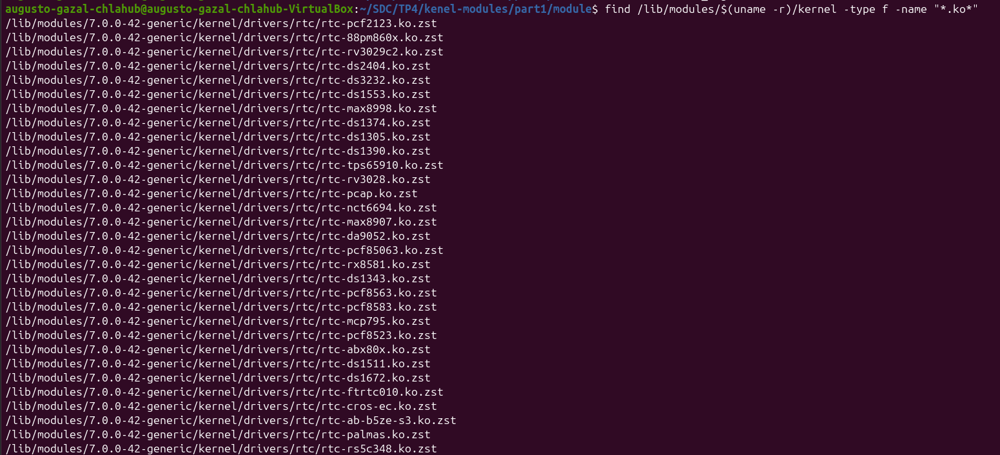

#### ¿Qué ocurre cuando el driver de un dispositivo no está disponible?
1. El bus correspondiente (PCI, USB, I2C, etc.) detecta eléctricamente el dispositivo y lee sus identificadores (por ejemplo, `Vendor ID` y `Device ID`), por lo que el dispositivo puede aparecer en `lspci` o `lsusb`.
2. El kernel emite un evento hacia `udev`, que busca en `/lib/modules/$(uname -r)/modules.alias` un módulo coincidente para cargarlo con `modprobe`.
3. Al no existir ningún módulo compatible (ni soporte *built-in* en el kernel), el dispositivo queda **sin controlador asignado** (*unclaimed*): no se crean nodos funcionales en `/dev` ni interfaces en el sistema (red, audio, video acelerado), y las aplicaciones de usuario no pueden interactuar con él. En casos donde existe un driver genérico (como `vesa`/`efifb` para video o `hid_generic` para periféricos básicos), el dispositivo opera en modo degradado o con funcionalidad mínima.

---

### 4. Relevamiento de hardware (`hw-probe`)

Se ejecutó la herramienta de relevamiento de hardware y diagnóstico de drivers mediante el comando indicado:

```bash
sudo -E hw-probe -all -upload -check -decode-acpi
```

- **URL generada en Linux Hardware:** https://linux-hardware.org/?probe=420a6db378

#### Aclaración sobre el entorno de ejecución (máquina virtual)

El relevamiento fue realizado dentro del entorno de trabajo del práctico —una **máquina virtual Ubuntu ejecutándose sobre VirtualBox**— y no directamente sobre hardware físico (*bare metal*). Esta condición se refleja de forma directa en los datos reportados por el *probe*:

- **Dispositivos PCI/periféricos emulados:** en lugar de exponer la placa madre, la placa de video o los adaptadores físicos del equipo anfitrión, `hw-probe` releva el hardware virtual provisto por el hipervisor (controlador gráfico `vmwgfx`, placa de red Ethernet Intel `e1000`, controlador de audio AC97 `snd_intel8x0`, controladora SATA `ahci` y el dispositivo de integración `vboxguest`), en total correspondencia con los módulos cargados observados mediante `lsmod` en la Actividad 2.
- **Tablas ACPI y firmware (`-decode-acpi`):** la información DMI/SMBIOS y las tablas ACPI decodificadas corresponden al firmware virtual generado por VirtualBox, por lo que no se detectan sensores térmicos reales, controladores de energía propios de la placa base física ni dispositivos PCI/USB que no hayan sido redirigidos explícitamente a la VM.
- **Procesador:** el hipervisor expone el modelo del procesador del anfitrión hacia el sistema invitado, aunque limitando ciertas banderas y la cantidad de núcleos asignados a la máquina virtual.

---

### 5. Diferencia entre un módulo del kernel y un programa de usuario

| Criterio | Programa de usuario | Módulo del kernel (`.ko`) |
| :--- | :--- | :--- |
| **Nivel de privilegio** | Modo usuario (**Ring 3**), con acceso restringido al hardware y memoria aislada | Modo supervisor/kernel (**Ring 0**), con acceso irrestricto a memoria física, registros e instrucciones privilegiadas |
| **Ciclo de ejecución** | Flujo secuencial: inicia en `main()`, ejecuta instrucciones y finaliza al retornar o llamar a `exit()` | Basado en eventos: se registra mediante `module_init()`, permanece residente en memoria respondiendo a llamadas/interrupciones y se libera en `module_exit()` |
| **Bibliotecas disponibles** | Biblioteca estándar de C (`glibc`: `printf`, `malloc`, `fopen`, etc.) y bibliotecas externas | **No puede usar `glibc`**. Solo dispone de la API interna exportada por el kernel (`printk`, `kmalloc`, `copy_to_user`, etc.) |
| **Gestión de memoria y fallos** | Posee espacio de direcciones virtual propio; un fallo grave termina solo ese proceso (`SIGSEGV`) sin afectar al sistema | Comparte el espacio de direcciones del kernel; un error de memoria provoca un *Kernel Oops* o *Kernel Panic* que puede colgar todo el sistema |
| **Formato y carga** | Ejecutable ELF lanzado por el loader vía `execve()` | Archivo objeto relocalizable ELF (`.ko`) enlazado dinámicamente al kernel en ejecución con `insmod` / `modprobe` |

---

### 6. Llamadas al sistema de un *Hello World* en C (`strace`)

Para observar todas las llamadas al sistema (*syscalls*) que efectúa un programa en C al ejecutarse, se utiliza la herramienta **`strace`**, que intercepta la interfaz entre el espacio de usuario y el kernel mediante `ptrace`.

```bash
gcc hola_mundo.c -o hola_mundo
strace ./hola_mundo
```

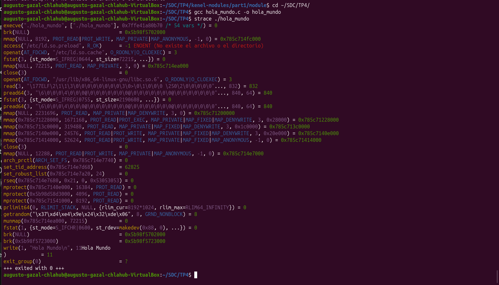

Aunque el código fuente solo contiene un `printf("Hola Mundo\n")`, la salida de `strace` muestra toda la infraestructura necesaria para iniciar y finalizar un proceso en Linux:

1. **Carga del binario (`execve`):** reemplaza la imagen del proceso con `./hola_mundo`.
2. **Carga dinámica de bibliotecas (`access`, `openat`, `fstat`, `read`, `pread64`, `mmap`, `close`):** el enlazador dinámico abre `/etc/ld.so.cache` y luego la biblioteca estándar `/usr/lib/x86_64-linux-gnu/libc.so.6`, mapeando sus segmentos de código y datos en memoria virtual y ajustando permisos con `mprotect`.
3. **Inicialización del entorno de ejecución (`arch_prctl`, `set_tid_address`, `set_robust_list`, `prlimit64`, `getrandom`, `brk`):** configura el *Thread Local Storage*, límites de pila, entropía y el *heap* del proceso.
4. **Impresión en pantalla (`write`):** `printf()` finalmente invoca `write(1, "Hola Mundo\n", 11)` sobre el descriptor de archivo `1` (`stdout`), devolviendo `11` bytes escritos.
5. **Finalización (`exit_group`):** cierra el proceso devolviendo código `0` al kernel (`+++ exited with 0 +++`).

---

### 7. *Segmentation fault*: qué es y cómo lo manejan el kernel y un programa de usuario

#### ¿Qué es un *segmentation fault*?
Un **fallo de segmentación** (*segmentation fault* o `SIGSEGV`) ocurre cuando un proceso intenta acceder a una dirección de memoria virtual que no le pertenece, no está mapeada en su tabla de páginas o viola los permisos asignados a esa región (por ejemplo, desreferenciar un puntero `NULL`, escribir en memoria de solo lectura o desbordar el *stack*).

#### ¿Cómo lo maneja el kernel?
1. Al ejecutarse la instrucción inválida, la **MMU** (*Memory Management Unit*) detecta la violación y genera una excepción de hardware (**Page Fault**, vector 14 en x86).
2. El procesador cambia a modo kernel (Ring 0) y salta al manejador de excepciones del kernel (`do_page_fault`).
3. El kernel inspecciona las estructuras de memoria del proceso (`mm_struct` / `vm_area_struct`) para verificar si se trata de un fallo recuperable (como *demand paging* o *Copy-on-Write*).
4. Al confirmar que el acceso es ilegal:
   - Si ocurrió en **espacio de usuario**, el kernel protege al resto del sistema enviando la señal **`SIGSEGV`** al proceso infractor.
   - Si el acceso inválido ocurrió dentro del propio **espacio de kernel** (por ejemplo, un puntero nulo en un módulo `.ko`), el kernel no puede simplemente enviarse una señal a sí mismo: registra un **Kernel Oops** (volcado de registros y *stack trace*), mata el hilo afectado y, si el fallo ocurrió en contexto de interrupción o dejó estructuras críticas inconsistentes, detiene todo el sistema con un **Kernel Panic**.

#### ¿Cómo lo maneja un programa de usuario?
- **Comportamiento por defecto:** el proceso no captura `SIGSEGV`, por lo que el kernel lo termina inmediatamente, libera sus recursos, devuelve un código de salida no nulo (típicamente `139` en shell, `128 + 11`) y opcionalmente genera un volcado de memoria (*core dump*) para depuración.
- **Manejo personalizado:** un programa puede registrar un manejador con `sigaction(SIGSEGV, ...)` (o `signal()`) para interceptar la señal, registrar un mensaje de diagnóstico o intentar una salida controlada; sin embargo, continuar la ejecución normal tras un `SIGSEGV` suele ser inseguro salvo casos muy específicos (como recolectores de basura o emuladores que reparan el mapeo con `mprotect`).

---

### 8. (Opcional avanzado) Firmado digital de un módulo del kernel

Para firmar `mimodulo.ko` se generó un par de claves RSA de 2048 bits junto con un certificado X.509 en formato DER (`MOK.priv` y `MOK.der`) utilizando `openssl`, y luego se aplicó la firma SHA-256 mediante el script oficial `sign-file` incluido en los headers del kernel:

```bash
openssl req -new -x509 -newkey rsa:2048 -keyout MOK.priv -outform DER -out MOK.der -nodes -days 36500 -subj "/CN=MiModulo/"
/usr/src/linux-headers-$(uname -r)/scripts/sign-file sha256 ./MOK.priv ./MOK.der mimodulo.ko
modinfo mimodulo.ko
```

Tras firmar el binario, `modinfo mimodulo.ko` incorpora los campos `sig_id: PKCS#7`, `signer: MiModulo`, `sig_key` y el bloque hexadecimal `signature`. Finalmente, se descargó la versión anterior y se recargó el módulo firmado verificando su presencia en `lsmod`.

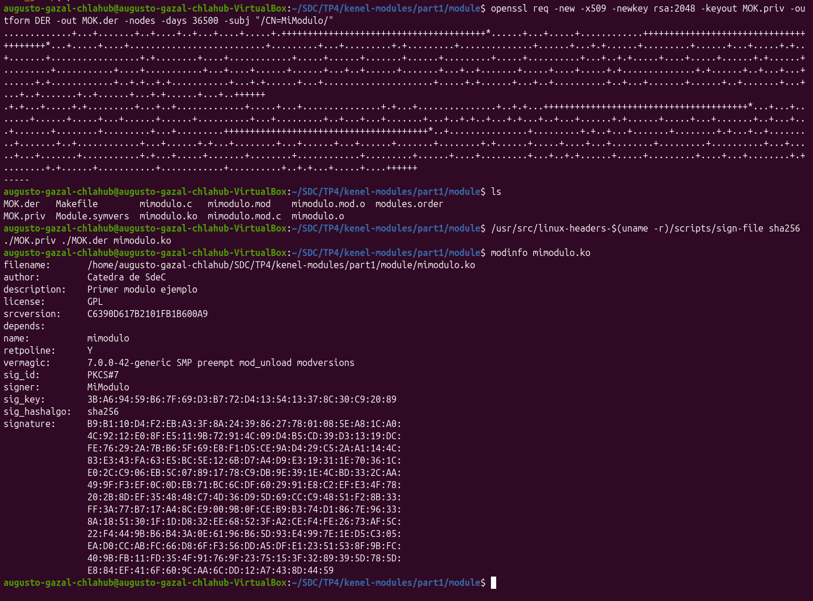
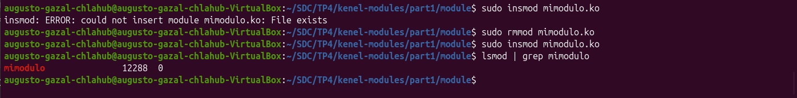

---

### 9. Módulo propio con identificación del grupo (`modulo_propio.c`)

Se desarrolló el módulo propio [`Modulo_propio/modulo_propio.c`](Modulo_propio/modulo_propio.c), cuya función de inicialización imprime `"Modulo cargado en el kernel. Grupo Hijos del AOE4"` y su función de limpieza imprime `"Modulo descargado del kernel. Grupo Hijos del AOE4"` a través de `printk`.

```bash
make all
sudo insmod modulo_propio.ko
sudo dmesg | tail
sudo rmmod modulo_propio.ko
sudo dmesg | tail
```

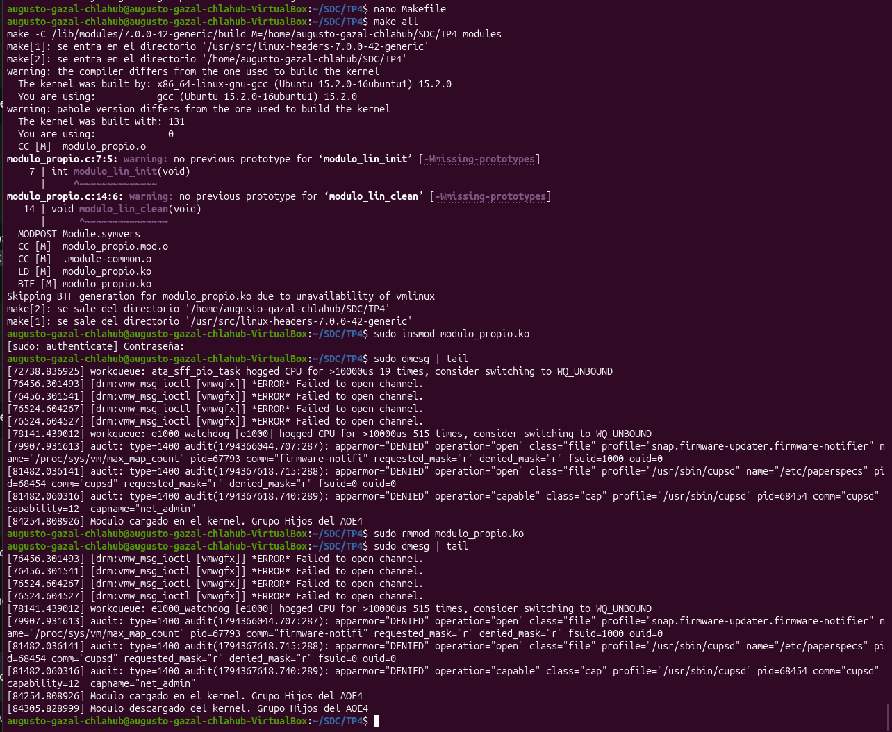

---

### 10. ¿Qué ocurre si un compañero con Secure Boot habilitado intenta cargar un módulo firmado por vos?

**El kernel rechazará la carga del módulo**, devolviendo el error:

```text
insmod: ERROR: could not insert module mimodulo.ko: Key was rejected by service
```
*(o `Required key not available`, código de error `EKEYREJECTED` / `ENOKEY`).*

**Motivo:** cuando UEFI Secure Boot está habilitado, el kernel de Linux activa el modo *lockdown* y exige que todo módulo `.ko` esté firmado por una clave cuya **clave pública esté previamente registrada como confiable** en el llavero del kernel (las claves del fabricante/distribución en UEFI `db` o las claves de propietario enroladas en **MOK** — *Machine Owner Key*).

Aunque el módulo está correctamente firmado con la clave privada (`MOK.priv`), la computadora de la otra persona **no conoce ni confía en ese certificado público (`MOK.der`)**. Para poder cargarlo sin desactivar Secure Boot, la otra persona debería importar tu certificado público con `sudo mokutil --import MOK.der`, reiniciar el equipo y aprobar manualmente la clave en la interfaz azul de *MOK Manager* al arrancar.

---

### 11. Análisis del artículo de Ars Technica (2024) sobre el parche de Microsoft (SBAT) y GRUB

En agosto de 2024, Microsoft distribuyó una actualización de seguridad de Windows destinada a aplicar políticas **SBAT** (*Secure Boot Advanced Targeting*) para revocar versiones antiguas y vulnerables del gestor de arranque GRUB (CVE-2022-2601). Aunque la actualización no debía aplicarse en equipos con arranque dual, la detección falló en una gran cantidad de sistemas.

- **¿Cuál fue la consecuencia principal del parche en sistemas de arranque dual?**  
  Al reiniciar luego de actualizar Windows, los sistemas *dual-boot* (Windows + Linux) quedaron imposibilitados de iniciar Linux mientras Secure Boot estuviera activo. El gestor `shim` bloqueaba el arranque mostrando el error:  
  `Verifying shim SBAT data failed: Security Policy Violation. Something has gone seriously wrong: SBAT self-check failed`.

- **¿Qué implicancia tiene desactivar Secure Boot como solución?**  
  Si bien deshabilitar Secure Boot desde la UEFI permite volver a arrancar Linux de inmediato, **rompe la cadena de confianza criptográfica del arranque**. Esto deja al equipo vulnerable a ataques de bajo nivel como **bootkits** o rootkits persistentes capaces de modificar el cargador de arranque o inyectar código malicioso antes de que se cargue el sistema operativo (donde los antivirus tradicionales no tienen visibilidad). Adicionalmente, en Windows puede provocar solicitudes de clave de recuperación de BitLocker o incompatibilidades con software que exige Secure Boot activo.

- **¿Cuál es el propósito principal de Secure Boot?**  
  Establecer y garantizar una **cadena de confianza (*chain of trust*)** durante el proceso de encendido del equipo. El firmware UEFI verifica criptográficamente la firma digital del gestor de arranque (*bootloader*), y este a su vez verifica la firma del kernel y sus módulos críticos, asegurando que únicamente software auténtico y autorizado por claves confiables pueda ejecutarse antes de entregar el control al sistema operativo.

---

## Desafío #1 — `checkinstall` y seguridad

### 1. ¿Qué es `checkinstall` y para qué sirve?
`checkinstall` es una herramienta de línea de comandos para Linux que monitorea los cambios realizados por un proceso de instalación desde código fuente (típicamente `make install`) y empaqueta automáticamente todos los archivos instalados en un paquete nativo de la distribución (`.deb` en Debian/Ubuntu, `.rpm` en Red Hat/Fedora o `.tgz` en Slackware). Su principal utilidad es permitir que software compilado localmente quede registrado en el gestor de paquetes del sistema (`dpkg`/`apt`), facilitando su distribución a otras máquinas y su desinstalación limpia (`dpkg -r`) sin dejar archivos huérfanos en el sistema.

---

### 2. Empaquetado con `checkinstall` e instalación en dos máquinas

Se realizaron dos etapas en la carpeta [`Checkinstall/`](Checkinstall/):

1. **Prueba inicial individual (`hello_check`):** se compiló `hello_check.c`, se generó `checkinstall_20261111-1_amd64.deb`, se verificó la ejecución global del comando `hello_check` desde `/usr/local/bin/` y se comprobó su remoción limpia con `sudo dpkg -r checkinstall`.
2. **Paquete final combinado (`tp4-programas` v1.0):** se integraron tanto `hello_check.c` como la aplicación de *stack frame* (`stack_frame.c`) en un único `Makefile` y se generó el paquete definitivo `tp4-programas_1.0-1_amd64.deb`:

```bash
make clean
make
sudo checkinstall --pkgname=tp4-programas --pkgversion=1.0 --default
```

| Prueba individual (`hello_check`) | Ejecución y desinstalación con `dpkg -r` |
| :---: | :---: |
| 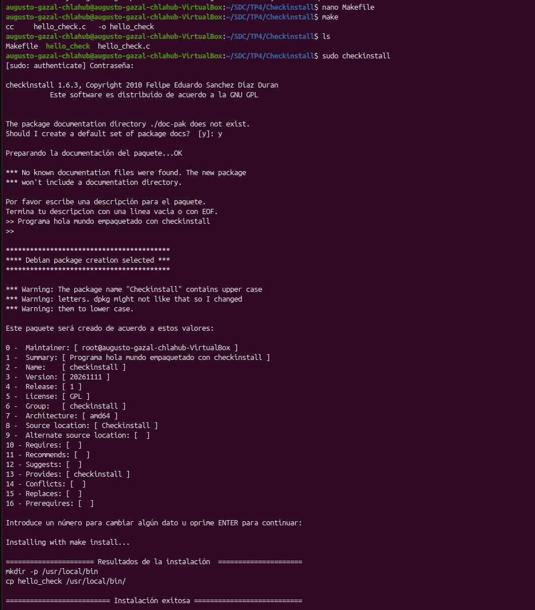 | 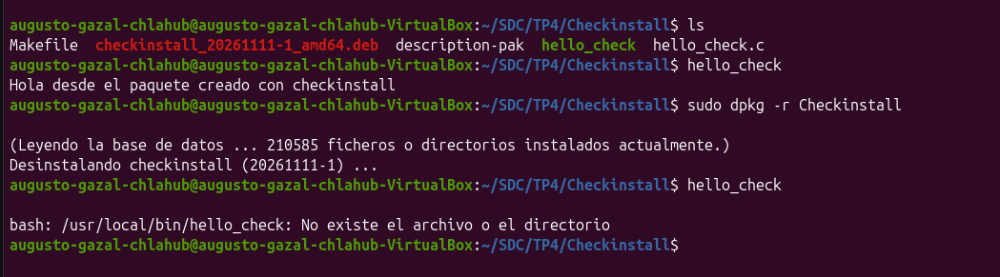 |

| Empaquetado combinado (`tp4-programas`) | Verificación y ejecución de `stack_frame` |
| :---: | :---: |
| 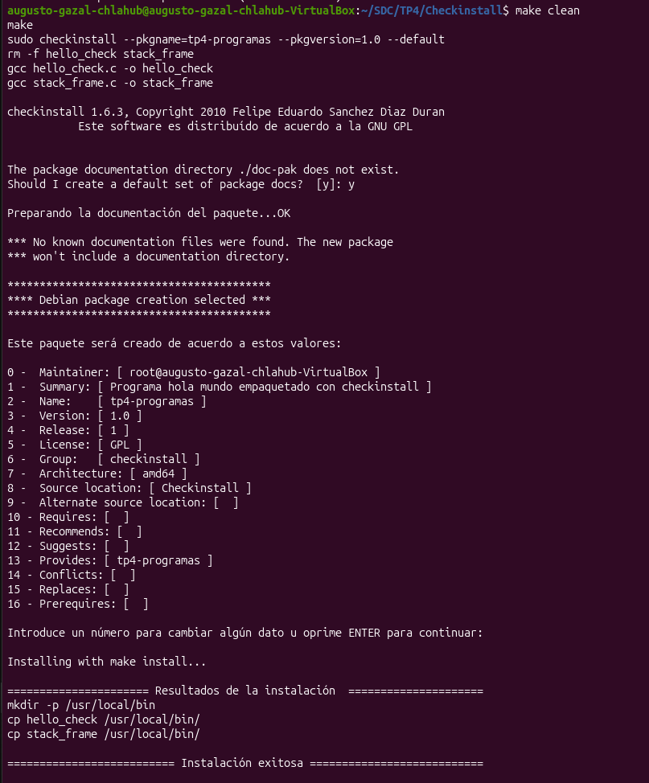 | 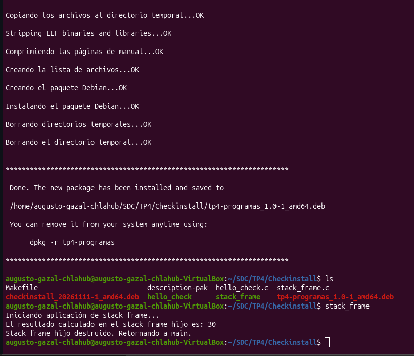 |

#### Instalación en una segunda máquina
El archivo [`Checkinstall/tp4-programas_1.0-1_amd64.deb`](Checkinstall/tp4-programas_1.0-1_amd64.deb) se compartió para instalarlo en el equipo de Lorenzo mediante:

```bash
sudo dpkg -i tp4-programas_1.0-1_amd64.deb
hello_check
stack_frame
```

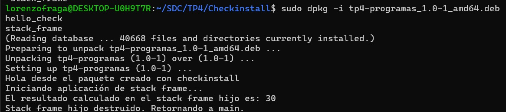

---

### 3. Investigación: cómo mejorar la seguridad del kernel

#### Evitar cargar módulos no firmados
- **Compilación estricta del kernel:** activar `CONFIG_MODULE_SIG=y` y `CONFIG_MODULE_SIG_FORCE=y`, que obliga a verificar firmas criptográficas en todos los `.ko`.
- **Parámetro de arranque del kernel:** agregar `module.sig_enforce=1` en la línea de comandos de GRUB para rechazar cualquier módulo sin firma válida en tiempo de ejecución.
- **Secure Boot + Kernel Lockdown:** en modo *integrity* o *confidentiality*, el kernel bloquea automáticamente la carga de módulos no firmados y restringe interfaces peligrosas como `/dev/mem` o `kexec`.
- **Bloqueo total post-arranque:** establecer `sysctl -w kernel.modules_disabled=1` una vez finalizada la secuencia de inicio; a partir de ese instante no se puede cargar ni descargar ningún módulo adicional hasta reiniciar el sistema.

#### Técnicas contra rootkits
- **Verificación de integridad de archivos y arranque:** uso de **IMA/EVM** (*Integrity Measurement Architecture*), **dm-verity** (particiones de solo lectura verificadas por hash) y herramientas de integridad como **AIDE** o **Tripwire** para detectar binarios o módulos alterados.
- **Detección activa de rootkits:** herramientas como **`rkhunter`**, **`chkrootkit`** y **`LKRG`** (*Linux Kernel Runtime Guard*), que monitorean modificaciones en la tabla de llamadas al sistema (*syscall table*), módulos ocultos en `lsmod` pero visibles en memoria, y escaladas inesperadas de credenciales de procesos.
- **Auditoría y observabilidad desde el kernel:** uso de **`auditd`** y sensores basados en **eBPF** (por ejemplo, Falco o Tracee) para detectar intentos de inserción de módulos (`init_module` / `finit_module`) o comportamientos anómalos en tiempo real.

#### Herramientas y estrategias de seguridad del kernel (*hardening*)
- **Control de Acceso Obligatorio (MAC):** **SELinux** y **AppArmor** confinan procesos según políticas estrictas de menor privilegio, limitando el daño incluso si un servicio es comprometido.
- **Filtrado de llamadas al sistema:** **Seccomp-BPF** reduce la superficie de ataque restringiendo qué *syscalls* puede invocar cada aplicación o contenedor.
- **Mitigaciones en memoria y CPU:** **KASLR** (aleatorización de direcciones del kernel), **SMEP/SMAP** (impiden que el kernel ejecute o acceda arbitrariamente a páginas de espacio de usuario), protección de pila (*stack canaries*) y memoria estricta `W^X` (ninguna página escribible y ejecutable simultáneamente).
- **Endurecimiento vía `sysctl`:** ocultar punteros del kernel (`kernel.kptr_restrict=2`), restringir `dmesg` a root (`kernel.dmesg_restrict=1`), limitar `ptrace` (`kernel.yama.ptrace_scope=1`) y deshabilitar `eBPF` sin privilegios (`kernel.unprivileged_bpf_disabled=1`).

---

## Desafío #2 — Conceptos fundamentales

### 1. ¿Qué funciones tiene disponible un programa de usuario y cuáles tiene un módulo del kernel?

- **Programa de usuario:** tiene acceso a las funciones de la biblioteca estándar de C (`glibc`) y bibliotecas dinámicas de espacio de usuario (`printf`, `scanf`, `malloc`, `free`, `fopen`, `pthread_create`, sockets POSIX, etc.), así como a los servicios del sistema operativo a través de **llamadas al sistema** (`read`, `write`, `openat`, `mmap`, `fork`, `execve`). No puede invocar directamente funciones internas del kernel ni acceder a registros de hardware o interrupciones.
- **Módulo del kernel:** carece por completo de `glibc` y no debe realizar operaciones de punto flotante arbitrarias ni llamadas al sistema convencionales. En su lugar, solo puede utilizar las **funciones y símbolos exportados por el propio kernel** (`EXPORT_SYMBOL` / `EXPORT_SYMBOL_GPL`), visibles en `/proc/kallsyms`. Entre ellas se incluyen: registro de mensajes (`printk`, `pr_info`), reserva de memoria en kernel (`kmalloc`, `kfree`, `vmalloc`), transferencia segura entre espacios (`copy_to_user`, `copy_from_user`), registro de dispositivos e interrupciones (`register_chrdev`, `request_irq`), primitivas de sincronización (`spin_lock`, `mutex_lock`) y macros de ciclo de vida (`module_init`, `module_exit`).

---

### 2. Espacio de usuario, espacio de kernel y espacio de datos

En un sistema operativo moderno con memoria virtual (arquitectura x86_64/ARM64), el mapa de direcciones virtuales se divide en regiones protegidas por hardware (MMU):

- **Espacio de usuario (*User Space*):** porción del espacio de direcciones virtuales asignada de forma aislada a cada proceso (ejecutado en nivel de privilegio no privilegiado, **Ring 3**). Contiene el código ejecutable del programa, sus bibliotecas compartidas (`libc`, etc.) y su memoria privada. Un proceso no puede leer ni modificar la memoria de otro proceso ni del kernel; toda interacción con recursos del sistema requiere una transición controlada mediante una *syscall*.
- **Espacio de kernel (*Kernel Space*):** región reservada y protegida de la memoria virtual donde residen el núcleo de Linux, sus estructuras de control (planificador, tablas de páginas, VFS, pilas de red) y todos los módulos `.ko` cargados. Solo es accesible cuando el procesador opera en modo supervisor (**Ring 0**). Es compartido entre todos los procesos y tiene control directo sobre el hardware.
- **Espacio de datos (*Data Segment / Data Space*):** dentro del layout de memoria de un programa (o de un módulo), es la región destinada a almacenar las **variables y datos manipulados durante la ejecución**, diferenciada del segmento de código/texto (`.text`, solo lectura). Se compone de:
  - **`.data`:** variables globales y estáticas inicializadas explícitamente.
  - **`.bss`:** variables globales y estáticas no inicializadas (puestas en cero al cargar).
  - **Heap (montón):** memoria dinámica reservada en tiempo de ejecución (`malloc`/`brk`/`mmap` en espacio de usuario; `kmalloc`/`vmalloc` en espacio de kernel).
  - **Stack (pila):** marcos de pila (*stack frames*) con variables locales, parámetros y direcciones de retorno de las funciones activas.

---

### 3. Contenido de `/dev` y el rol de los drivers

#### ¿Qué contiene `/dev`?
El directorio `/dev` (montado en memoria mediante `devtmpfs` y gestionado dinámicamente por `udev`) sigue la filosofía de UNIX *"todo es un archivo"*. No almacena archivos regulares con datos en disco, sino **nodos de dispositivo** (*device files*) que representan hardware real o recursos virtuales del kernel:

- **Dispositivos de caracteres (`c` en `ls -l`):** transfieren datos como un flujo secuencial de bytes sin búfer de bloques (por ejemplo, `/dev/ttyAMA0`, `/dev/input/mice`, `/dev/snd/*`).
- **Dispositivos de bloques (`b` en `ls -l`):** permiten acceso aleatorio en bloques de tamaño fijo con caché del sistema (por ejemplo, discos y particiones como `/dev/sda`, `/dev/nvme0n1`, `/dev/mmcblk0p2`).
- **Pseudo-dispositivos virtuales:** implementados puramente por software en el kernel sin hardware físico asociado, como `/dev/null` (descarta toda escritura), `/dev/zero` (entrega flujo infinito de ceros) y `/dev/urandom` (generador de números pseudoaleatorios).

Cada nodo en `/dev` posee dos identificadores numéricos clave: el **número mayor (*major*)**, que indica al kernel **qué driver** controla ese dispositivo, y el **número menor (*minor*)**, que distingue **qué instancia o partición específica** maneja ese driver.

#### ¿Cuál es el rol de los drivers?
Los **drivers** (controladores de dispositivo) actúan como la capa de traducción y abstracción entre el hardware (registros MMIO, puertos I/O, DMA, interrupciones IRQ) y el **Sistema de Archivos Virtual (VFS)** del kernel. Al implementar una estructura estándar de operaciones (`file_operations`: `open`, `read`, `write`, `ioctl`, `release`), permiten que cualquier programa en espacio de usuario interactúe con dispositivos completamente distintos mediante las mismas llamadas al sistema estándar sobre los archivos en `/dev`, ocultando la complejidad eléctrica y de protocolo de cada fabricante.

---

## Anexo — Emulación de Raspberry Pi (QEMU) y Compilación Cruzada (`aarch64`)

Como trabajo complementario para validar la portabilidad de módulos del kernel entre arquitecturas distintas, se emuló una **Raspberry Pi 3 Model B+** de 64 bits (`aarch64`) con **QEMU** y se realizó la **compilación cruzada** del módulo propio [`Raspberry/modulo_raspberry/modulo_propio.c`](Raspberry/modulo_raspberry/modulo_propio.c) desde Ubuntu `x86_64`.

### 1. Extracción de kernel y Device Tree, y arranque con QEMU
Se inspeccionó la tabla de particiones de la imagen `2023-05-03-raspios-bullseye-arm64.img` con `fdisk -l`, se montó la partición `/boot` (`offset=4194304`) para extraer `kernel8.img` y `bcm2710-rpi-3-b-plus.dtb`, y se inició el emulador con red USB y redirección de puerto SSH (`2222 -> 22`):

```bash
qemu-system-aarch64 -machine raspi3b -cpu cortex-a72 -nographic \
  -dtb bcm2710-rpi-3-b-plus.dtb -m 1G -smp 4 -kernel kernel8.img \
  -sd 2023-05-03-raspios-bullseye-arm64.img \
  -append "rw earlyprintk loglevel=8 console=ttyAMA0,115200 dwc_otg.lpm_enable=0 root=/dev/mmcblk0p2 rootdelay=1" \
  -device usb-net,netdev=net0 -netdev user,id=net0,hostfwd=tcp::2222-:22
```

| Particiones y montaje de imagen | Contenido de `/boot` (`kernel8.img` y `.dtb`) |
| :---: | :---: |
| 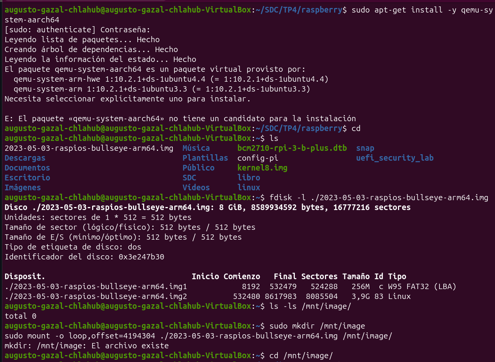 | 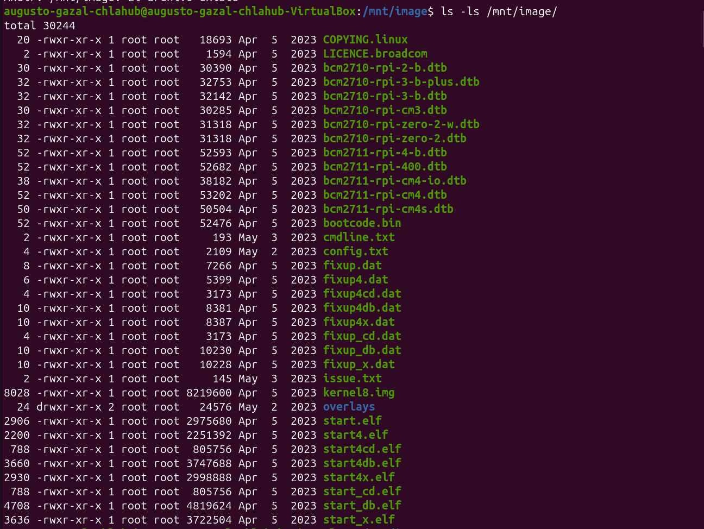 |

| Arranque de QEMU `aarch64` | Login en consola serial `ttyAMA0` |
| :---: | :---: |
| 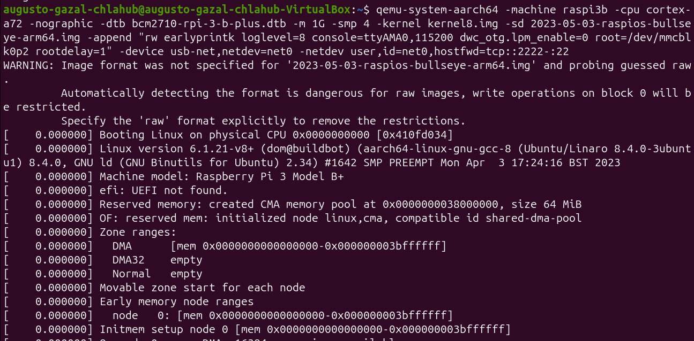 | 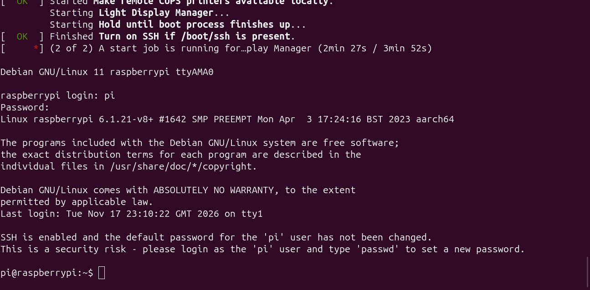 |

### 2. Preparación del entorno y compilación cruzada
Mediante SSH (`ssh -p 2222 pi@localhost`) se verificó el kernel activo (`6.1.21-v8+`, `aarch64`) y se extrajo su configuración exacta desde `/proc/config.gz`. Luego, en el host Ubuntu (`x86_64`), se clonó el árbol del kernel de Raspberry Pi (tag `1.20230405`), se prepararon los encabezados con `gcc-aarch64-linux-gnu` (`olddefconfig` + `modules_prepare`) y se compiló `modulo_propio.ko`.

| Conexión SSH y extracción de `config-pi` | Preparación del árbol del kernel `arm64` |
| :---: | :---: |
| 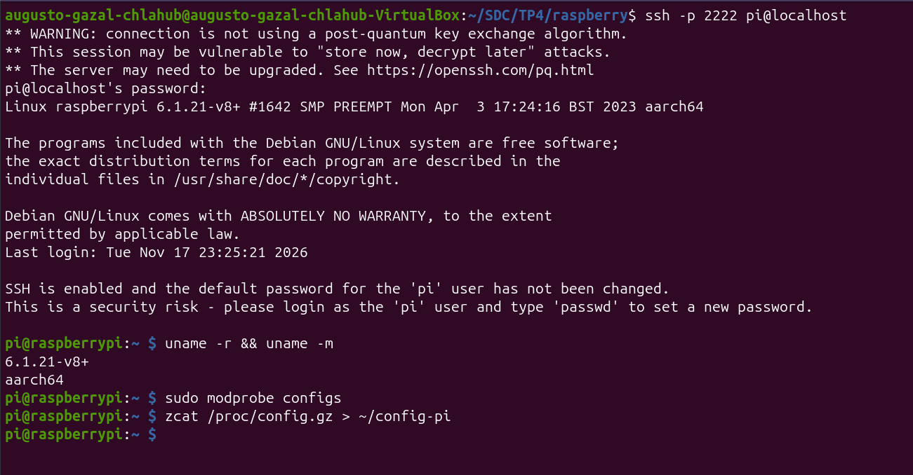 | 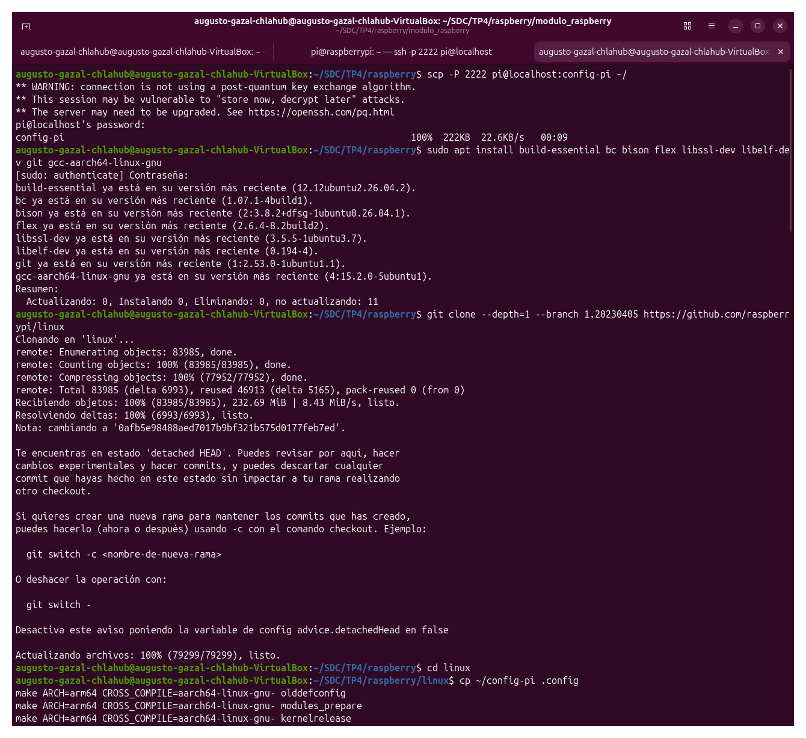 |

### 3. Verificación de arquitectura, transferencia y ejecución en ARM64
- `file modulo_propio.ko` confirmó el binario `ELF 64-bit LSB relocatable, ARM aarch64`.
- `modinfo` confirmó el `vermagic: 6.1.21-v8+ SMP preempt mod_unload modversions aarch64`.
- Al intentar insertarlo en el host Ubuntu `x86_64`, el kernel lo rechazó correctamente con `Invalid module format`, demostrando la incompatibilidad binaria entre arquitecturas.
- Finalmente, se transfirió vía `scp -P 2222 modulo_propio.ko pi@localhost:~` y se cargó/descargó con éxito dentro de la Raspberry Pi emulada, imprimiendo el mensaje del grupo `"Grupo Hijos del AOE4"` en `dmesg`.

| Compilación cruzada, prueba en x86_64 y `scp` | Carga y descarga exitosa en Raspberry Pi (`aarch64`) |
| :---: | :---: |
| 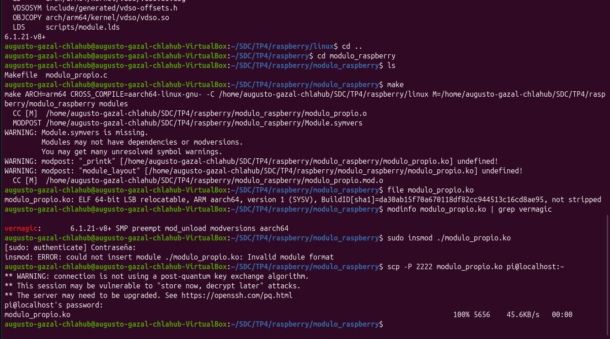 | 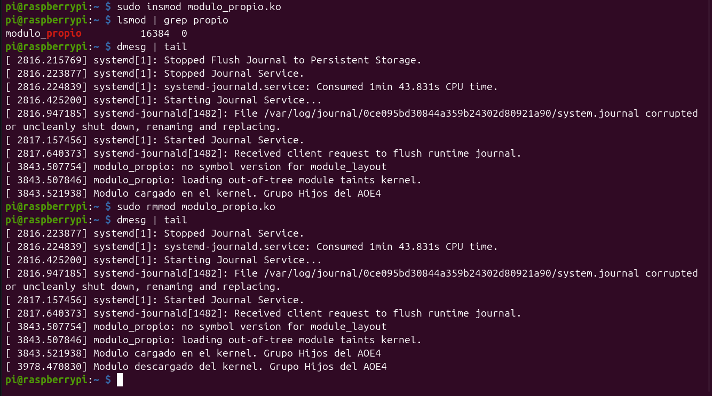 |